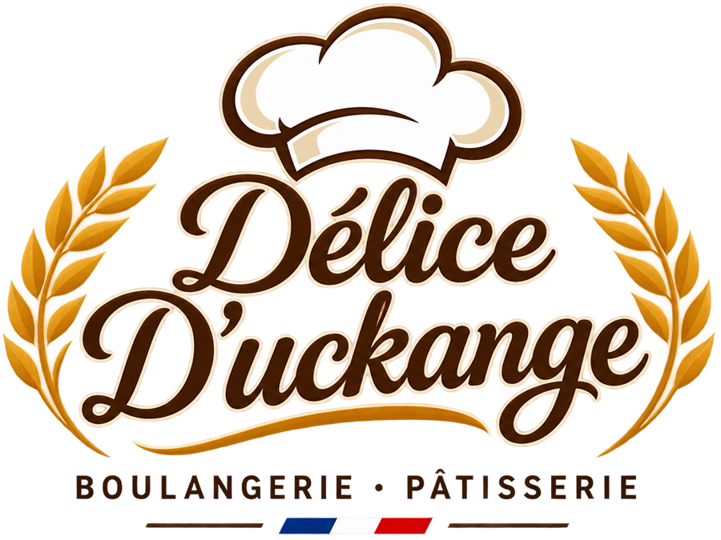

<div align="center">



# Délice D'Uckange — Site Web Officiel

**Boulangerie & Pâtisserie artisanale à Uckange, France**

[](https://nextjs.org)
[](https://www.typescriptlang.org)
[](https://tailwindcss.com)
[](https://www.framer.com/motion)
[](LICENSE)

---

*Pains frais · Viennoiseries dorées · Pâtisseries gourmandes · Gâteaux personnalisés*

[🌐 Voir le site](#) · [📍 11 Rue de Fameck, 57270 Uckange](https://maps.google.com/?q=11+Rue+de+Fameck,+57270+Uckange) · [📞 +33 3 82 53 62 97](tel:+33382536297)

</div>

---

## 📸 Aperçu

| Page | Description |
|------|-------------|
| **Accueil** | Hero plein-écran, catégories, engagements, CTA gâteaux, galerie, localisation, paiements |
| **Nos Produits** | Catalogue avec 5 catégories : Pains, Viennoiseries, Pâtisseries, Gâteaux, Snacking |
| **Commandes de Gâteaux** | Formulaire validé Zod avec récapitulatif copiable |
| **Galerie** | Grille filtrée avec lightbox clavier-accessible |
| **Contact** | Carte Google Maps, horaires, téléphone, itinéraire |

---

## ✨ Fonctionnalités

- 🎨 **Design système complet** — couleurs, typographies, ombres, espacements cohérents
- 📱 **Entièrement responsive** — Mobile, tablette et desktop
- ⚡ **Performances optimisées** — Next.js App Router, images WebP/AVIF, génération statique
- 🎬 **Animations fluides** — Framer Motion : révélations au scroll, parallaxe, hover, stagger
- 🔍 **SEO avancé** — Métadonnées françaises, JSON-LD LocalBusiness, sitemap, robots.txt
- ♿ **Accessibilité** — Navigation clavier, ARIA, focus visible, `prefers-reduced-motion`
- 💳 **Options de paiement** — 7 modes avec animations de marque au hover
- 🗺️ **Intégration Google Maps** — Avec l'adresse vérifiée
- 📝 **Formulaire gâteaux** — Validation Zod, états succès/erreur/non-configuré
- 🌐 **TikTok, Facebook, Instagram** intégrés dans le footer

---

## 🛠️ Stack technique

| Technologie | Rôle |
|-------------|------|
| [Next.js 16](https://nextjs.org) | Framework React (App Router, SSG) |
| [TypeScript 5](https://www.typescriptlang.org) | Typage statique |
| [Tailwind CSS 3.4](https://tailwindcss.com) | Styles utilitaires |
| [Framer Motion 14](https://www.framer.com/motion) | Animations |
| [Lucide React](https://lucide.dev) | Icônes |
| [React Hook Form](https://react-hook-form.com) | Gestion de formulaire |
| [Zod](https://zod.dev) | Validation des données |
| [Google Fonts](https://fonts.google.com) | Playfair Display · Lato · Montserrat |

---

## 🎨 Design System

```
Couleurs
├── Brun principal  #59402E
├── Caramel         #A87545
├── Beige           #E8D8BE
├── Crème           #F8F4EC
└── Texte           #34302A

Typographies
├── Titres    → Playfair Display (serif, italique)
├── Corps     → Lato (sans-serif)
└── Nav/CTA   → Montserrat (sans-serif, uppercase)
```

---

## 🚀 Démarrage rapide

### Prérequis

- [Node.js](https://nodejs.org) ≥ 20
- npm ≥ 9

### Installation

```bash
# Cloner le dépôt
git clone https://github.com/hamzalazigheb/D-lice-D-uckange.git
cd D-lice-D-uckange

# Installer les dépendances
npm install

# Copier la configuration d'environnement
cp .env.example .env.local

# Lancer le serveur de développement
npm run dev
```

Ouvrir [http://localhost:3000](http://localhost:3000)

### Scripts disponibles

```bash
npm run dev      # Serveur de développement (Turbopack)
npm run build    # Build de production
npm run start    # Serveur de production
```

---

## ⚙️ Configuration

Toutes les informations de la boutique sont centralisées dans un seul fichier :

### `src/lib/site.ts`

```ts
export const siteConfig = {
  // ✅ Renseignés
  contact: {
    address: { street: "11 Rue de Fameck", postalCode: "57270", city: "Uckange" },
    phone: "+33 3 82 53 62 97",
    openingHours: [/* Lun–Dim 05:00–20:00 */],
  },
  socials: {
    tiktok: "https://www.tiktok.com/@delices.duckange",
    // ⬇️ À compléter
    facebook: null,
    instagram: null,
  },
  // ⬇️ À compléter
  contact: {
    email: null,            // ex. "contact@delice-duckange.fr"
    mapEmbedUrl: null,      // URL d'intégration Google Maps
  },
};
```

### Variables d'environnement (`.env.local`)

| Variable | Description | Exemple |
|----------|-------------|---------|
| `NEXT_PUBLIC_SITE_URL` | URL publique du site en production | `https://delice-duckange.fr` |
| `NEXT_PUBLIC_CAKE_FORM_ENDPOINT` | Endpoint qui reçoit les demandes de gâteaux | `https://formspree.io/f/xxxxx` |

> **Note :** Tant que `NEXT_PUBLIC_CAKE_FORM_ENDPOINT` est vide, le formulaire affiche un récapitulatif copiable au lieu d'envoyer une requête.

---

## 📁 Structure du projet

```
delice-duckange/
├── public/
│   └── images/               # Photos et logo optimisés
├── scripts/
│   └── prepare-assets.ps1    # Script de traitement des images (Windows)
├── src/
│   ├── app/                  # Pages Next.js App Router
│   │   ├── page.tsx          # / — Accueil
│   │   ├── produits/         # /produits
│   │   ├── commandes-gateaux/# /commandes-gateaux
│   │   ├── galerie/          # /galerie
│   │   ├── contact/          # /contact
│   │   ├── sitemap.ts        # Sitemap automatique
│   │   └── robots.ts         # robots.txt
│   ├── components/
│   │   ├── home/             # Sections de la homepage
│   │   ├── layout/           # Header, Footer, Logo
│   │   ├── ui/               # Composants réutilisables
│   │   ├── products/         # Carte produit
│   │   ├── gallery/          # Grille + lightbox
│   │   ├── cake/             # Formulaire de commande
│   │   └── seo/              # JSON-LD structured data
│   └── lib/
│       ├── site.ts           # ⚙️ Config centrale de la boutique
│       ├── images.ts         # Registre des assets
│       ├── products.ts       # Données du catalogue
│       └── gallery.ts        # Données de la galerie
└── .env.example              # Variables d'environnement
```

---

## 🌍 Déploiement

### Vercel (recommandé)

1. Importer le dépôt sur [vercel.com](https://vercel.com)
2. Ajouter les variables d'environnement :
   - `NEXT_PUBLIC_SITE_URL` → votre domaine
   - `NEXT_PUBLIC_CAKE_FORM_ENDPOINT` → votre endpoint (optionnel)
3. Déployer → **zéro configuration requise**

### Formulaire de contact (optionnel)

Pour activer l'envoi réel des demandes de gâteaux, configurez un service comme :
- [Formspree](https://formspree.io) — gratuit jusqu'à 50 soumissions/mois
- [Getform](https://getform.io)
- Votre propre API

Puis renseignez l'URL dans `NEXT_PUBLIC_CAKE_FORM_ENDPOINT`.

---

## 📊 Pages et SEO

| Page | Title | Description |
|------|-------|-------------|
| `/` | Boulangerie Pâtisserie à Uckange | Accueil + JSON-LD LocalBusiness |
| `/produits` | Nos produits — Pains, viennoiseries… | Catalogue complet |
| `/commandes-gateaux` | Commandes de gâteaux personnalisés | Formulaire de demande |
| `/galerie` | Galerie photos | Grille filtrée |
| `/contact` | Contact et accès | Carte + horaires |

**Mots-clés ciblés :** `Boulangerie Uckange` · `Pâtisserie Uckange` · `Gâteaux personnalisés Uckange` · `Boulangerie artisanale Uckange`

---

## 📌 À compléter par le commerçant

- [ ] `email` dans `src/lib/site.ts`
- [ ] `facebook` et `instagram` dans `src/lib/site.ts`
- [ ] `mapEmbedUrl` (URL Google Maps Embed) dans `src/lib/site.ts`
- [ ] `NEXT_PUBLIC_CAKE_FORM_ENDPOINT` pour activer le formulaire
- [ ] `NEXT_PUBLIC_SITE_URL` sur le domaine de production
- [ ] Photos haute résolution des produits dans `public/images/`
- [ ] Prix du catalogue (activer `showPrices: true` dans `site.ts`)

---

## 📄 Licence

Ce projet est sous licence [MIT](LICENSE). © 2026 Délice D'Uckange.

---

<div align="center">

Développé avec ❤️ pour la boulangerie **Délice D'Uckange** — Uckange, France 🇫🇷

[](https://www.tiktok.com/@delices.duckange)

</div>
